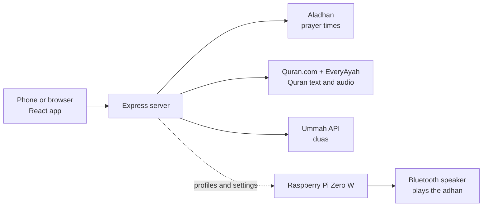

# Khushu

[](../../actions/workflows/ci.yml)

**An Islamic companion app with prayer times, a Quran reader, duas, and a dhikr counter, plus a small Raspberry Pi that plays the adhan at home automatically.**

**[Live demo](https://sahilh-spec.github.io/khushu-app/)** (static version: no server, no API keys)

<p>


</p>

_Screenshots use sample prayer times so the layout is visible without network access._

## What it is

Khushu is a web app that puts the everyday tools of a Muslim's day in one place:

- **Prayer times** for your location, with a live countdown to the next prayer
- **Quran reader** with Arabic, translation, transliteration, and audio
- **Duas, dhikr counter, the 99 Names, and a Qibla compass**
- **Adhan at home:** a Raspberry Pi plays the adhan through a Bluetooth speaker at every prayer time, with no phone needed

## Purpose

Khushu is a personal project that runs in a real household. Each family member gets their own profile with their own reciter and volume, so everyone hears the adhan the way they prefer.

## How it works



1. **Prayer times:** the server asks the Aladhan API for your location, saves the result for the day, and works out the next prayer and the countdown.
2. **Quran and duas:** the server fetches these from third-party APIs and passes them to the app, so API keys never reach the browser.
3. **Adhan at home:** a small program on the Raspberry Pi checks prayer times every minute, plays the adhan, then a dua, and reconnects the Bluetooth speaker after a reboot.

## Key decisions

- **Keys stay on the server.** The Duas API key is never sent to the browser.
- **One demo, no backend.** The live demo is the same React app built in a static mode that answers its own requests in the browser, so anyone can try it safely.
- **Per-person profiles.** Each household member keeps their own preferences. An owner-only admin profile is protected by a server-side token.
- **Plain Bluetooth speaker.** An Echo Dot works as a regular Bluetooth speaker, with no Alexa account involved.

## Tech at a glance

| Area | Tools |
|---|---|
| Frontend | React, Vite, Tailwind (UI started as a Figma Make export, then wired to the API) |
| Backend | Node.js, Express, JSON profile store |
| Data sources | Aladhan, Quran.com, EveryAyah, Ummah API |
| Adhan player | Raspberry Pi Zero W, `mpg123`, PulseAudio, Bluetooth, systemd |
| Hosting | Railway (app), GitHub Pages (demo), GitHub Actions (CI) |

## Run it locally

```bash
cd adhan-hub
cp .env.example .env     # set LATITUDE, LONGITUDE, TIMEZONE
npm install
npm run build:client     # needs pnpm: npm i -g pnpm
npm start                # http://localhost:3000
```

The adhan and dua recordings are **not** in this repository. Add your own MP3s to `adhan-hub/public/audio/` and `adhan-hub/client/public/audio/` (file names are listed in [docs/TECHNICAL.md](docs/TECHNICAL.md)), and make sure you have the right to use them.

## More detail

- Technical breakdown (deployment, security notes, static demo build): [docs/TECHNICAL.md](docs/TECHNICAL.md)
- Raspberry Pi setup (hardware, Bluetooth pairing, systemd, troubleshooting): [adhan-hub/pi/README.md](adhan-hub/pi/README.md)

## Status and limits

Beta, one developer. Prayer times depend on the calculation method you choose, so always confirm with your local masjid. Quran text and audio come from the third-party APIs above. There is no AI feature in the current code.

## License

Code: MIT (see `LICENSE`). Audio recordings and API content belong to their owners and are not included.
