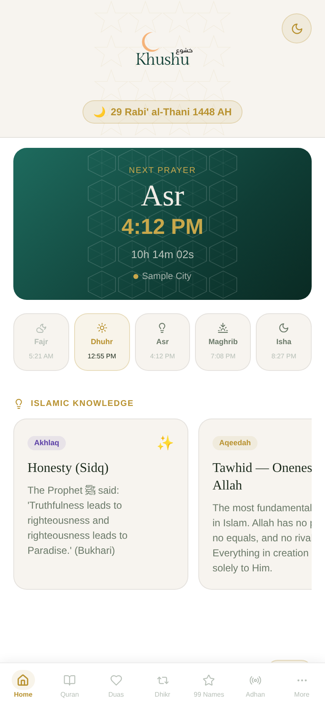
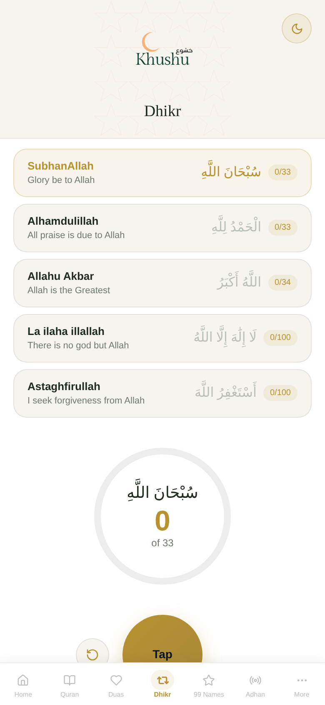
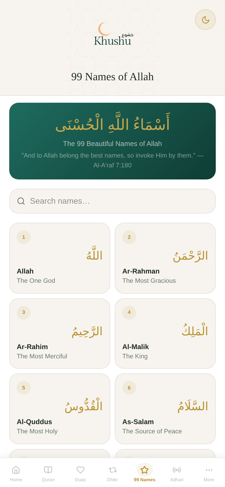
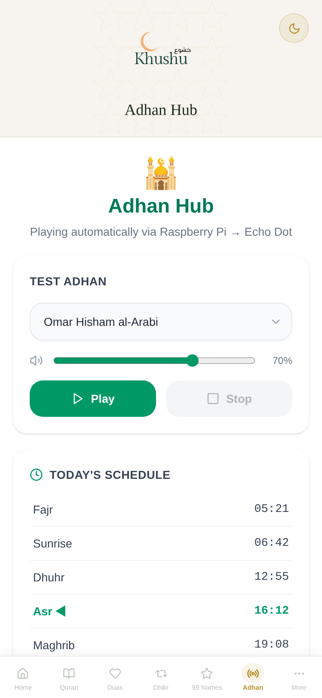

# Khushu

[](../../actions/workflows/ci.yml)

An all-in-one Islamic companion app: prayer times, a Quran reader with translation and audio, duas, dhikr counter, the 99 Names, Qibla direction, and a **Raspberry Pi that plays the adhan automatically at home** through a Bluetooth speaker.

Built by Sahil Khan as a personal project. I run it for my own household.

<p>
  
  
  
  
</p>

_Screenshots use sample prayer times so the layout is visible without network access._

## What it does

| Area | How it works |
|---|---|
| **Prayer times** | Express server calls the [Aladhan API](https://aladhan.com/prayer-times-api) for your coordinates and timezone, caches per day, and computes the next prayer and a live countdown. |
| **Quran** | Surah reader with Arabic (Uthmani / IndoPak), translation, transliteration, per-verse and full-surah audio. Text and audio come from the [Quran.com API](https://api.quran.com) and [EveryAyah](https://everyayah.com), proxied through the server. |
| **Duas** | Fetched from the [Ummah API](https://ummahapi.com) through a server-side proxy so the API key never reaches the browser. |
| **Dhikr, 99 Names, Qibla, reminders** | Client-side: dhikr counter, Names with meanings, compass using the device's location and orientation, browser prayer notifications. |
| **Profiles** | Each household member keeps their own adhan preferences (reciter, volume). An owner-only admin profile is protected by a server-side token. |
| **Pi adhan player** | A Raspberry Pi Zero W runs `local-player.js`, which checks prayer times every minute, plays the adhan MP3 through `mpg123`, then a rotating dua, over Bluetooth A2DP to a speaker (I use an Echo Dot as a plain Bluetooth speaker, no Alexa account involved). It runs as a systemd service and reconnects the speaker on boot. |

## Architecture

```
React + Vite + Tailwind (client/)  ──►  Express API (server.js, routes/, services/)
   UI started as a Figma Make          ├─ Aladhan (prayer times)
   export, then wired to the API       ├─ Quran.com + EveryAyah (Quran text and audio)
                                       ├─ Ummah API proxy (duas, key stays on server)
                                       └─ JSON profile store (data/config.json)

Raspberry Pi Zero W: local-player.js ─► mpg123 ─► PulseAudio ─► Bluetooth speaker
```

## Run it locally

```bash
cd adhan-hub
cp .env.example .env          # set LATITUDE, LONGITUDE, TIMEZONE; optionally ADMIN_TOKEN, UMMAH_API_KEY
npm install
npm run build:client          # builds the React app into adhan-hub/public (needs pnpm: npm i -g pnpm)
npm start                     # http://localhost:3000
```

The adhan and dua recordings are **not** in this repository. Put your own MP3s in `adhan-hub/public/audio/` (and `adhan-hub/client/public/audio/`):
`adhan-omar-hisham.mp3`, `adhan-ahmed-el-kourdi.mp3`, `adhan-fajr.mp3`, `dua-1.mp3` … `dua-4.mp3`. Make sure you have the right to use whatever recordings you choose.

Deploy: `railway.toml` is included. Set the variables from `.env.example` in your host, and mount a volume at `/app/data` so profiles survive redeploys.

Pi setup (hardware list, Bluetooth pairing, systemd service, troubleshooting): [`adhan-hub/pi/README.md`](adhan-hub/pi/README.md).

## Security notes

- Admin routes and the admin profile (which the Pi reads its settings from) require `ADMIN_TOKEN` (16+ characters), compared in constant time. Without it, admin features are disabled.
- Third-party API keys live only in environment variables. The Duas proxy only forwards `/duas` paths.
- No open CORS (the UI is served by the same server), API rate limiting, request body size limit, validated settings input.
- Profiles are a convenience for preferences, not an identity system: anyone who can reach the site can create a non-admin profile.
- `npm run test:security` starts the server and checks these behaviors (runs in CI).

## Status and limits

Beta, one developer. Prayer times depend on the calculation method you choose; always confirm with your local masjid. The Quran text and audio are served by the third-party APIs above. There is no AI/LLM feature in the current code.

## License

Code: MIT (see `LICENSE`). Audio recordings and API content belong to their owners and are not included.
